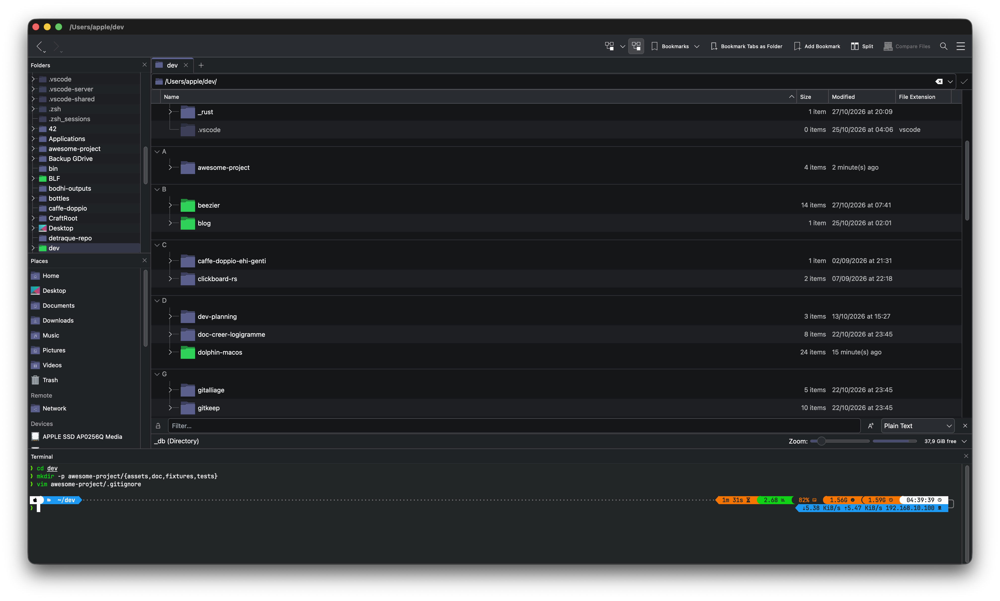

<div align="center">

# 🐬 Dolphin for macOS

**KDE's file manager, built for Apple silicon.**<br>
Upstream Dolphin on KDE Frameworks 6, with the fixes it needs on macOS: it launches from the Finder and the Dock, embeds a terminal, and opens your terminal app in the current folder.

[](LICENSES/)
[](#requirements)
[](https://develop.kde.org/products/frameworks/)
[](https://community.kde.org/Craft)
[](#known-issues)



<sub>Dolphin 26.11.70 on macOS 26.7.1, with the terminal panel open (<kbd>F4</kbd>).</sub>

</div>

> [!IMPORTANT]
> **Unofficial.** @KDE does not ship or support Dolphin on macOS. Report problems with this port here, not on bugs.kde.org, unless you have reproduced them on Linux.

## Contents

- [Why](#why)
- [What works](#what-works)
- [Requirements](#requirements)
- [Build and install](#build-and-install)
- [Terminal](#terminal) · [Embedded panel](#embedded-panel-f4) · [Open Terminal](#open-terminal)
- [Make Dolphin the default file viewer](#make-dolphin-the-default-file-viewer)
- [Known issues](#known-issues)
- [Troubleshooting](#troubleshooting)
- [Changes from upstream](#changes-from-upstream)
- [Credits](#credits)
- [License](#license)

## Why

People have been asking for Dolphin on macOS [since at least 2024](https://discuss.kde.org/t/dolphin-on-macos/20422). KDE builds macOS binaries for Konsole, Kate and others, but not for Dolphin: on 2026-10-29, [`cdn.kde.org/ci-builds/system/dolphin/`](https://cdn.kde.org/ci-builds/system/dolphin/) only had Windows builds. The old `kde-mac/kde` Homebrew tap is stuck on KDE Frameworks 5 and no longer builds.

Upstream Dolphin does build with [KDE Craft](https://community.kde.org/Craft), but it does not behave like a Mac app. Launched from the Finder or the Dock, it waits forever for a D-Bus session that macOS never provides, and shows no window. Open Terminal does nothing. The embedded terminal reports that Konsole is not installed.

This repository fixes those three problems, so you can have Dolphin and its embedded terminal (the main thing the Finder lacks) on a Mac.

## What works

| | Feature | Notes |
| --- | --- | --- |
| ✅ | **Launch from Finder, Dock, Spotlight, `open`** | D-Bus is disabled in-process, so the app no longer hangs at startup. |
| ✅ | **Embedded terminal** (<kbd>F4</kbd>) | Needs KonsolePart, built by Craft: see [Embedded panel](#embedded-panel-f4). |
| ✅ | **Open Terminal / Open Terminal Here** | Konsole, Ghostty, iTerm, Alacritty, kitty, WezTerm, then Terminal.app. |
| ✅ | **`open <folder>`, `open -R <file>`** | After setting Dolphin as the [default file viewer](#make-dolphin-the-default-file-viewer) and logging out. |
| ✅ | **Compress…** | `ditto`, `zip`, `tar`, and `7z` when installed. Single-item zips keep extended attributes, quarantine flag included. |
| ✅ | **Places, removable media** | Solid's IOKit backend. |
| ♻️ | **Open With** | Type an app path **without** the trailing slash; "Remember application association" has no effect. Both are upstream KIO bugs. |
| ♻️ | **Screen reader announcements in the file view** | Disabled to work around a crash in Qt's Cocoa accessibility bridge. Menus, toolbars and dialogs still work with VoiceOver. |
| ❌ | **Content search, tags, information panel** | They depend on Baloo, which is Linux-only. |

Tested on an iMac M1, macOS 26.7.1, Xcode 27.1, Qt 6.12. The port it builds on was tested on macOS 26.5.2. Intel Macs are untested.

## Requirements

- macOS on Apple silicon (arm64)
- Xcode, or the Command Line Tools
- Python 3, for Craft (Homebrew's 3.15 works)
- About **5 GB** of disk for `~/CraftRoot`, plus the build tree of this repository
- About **50 minutes** on an M1 for the first Craft run, mostly downloads of prebuilt packages

No Homebrew package is needed: Craft provides Qt, KDE Frameworks and every other dependency.

## Build and install

**1. Install Craft.**

```bash
curl -fsSL https://raw.githubusercontent.com/KDE/craft/master/setup/CraftBootstrap.py -o setup.py
python3 setup.py --prefix "$HOME/CraftRoot" --use-defaults
source "$HOME/CraftRoot/craft/craftenv.sh"
```

**2. Build the dependencies.** The first command brings Qt, KF6 and an upstream Dolphin, the second brings KonsolePart for the terminal panel.

```bash
craft kde/applications/dolphin
craft kde/applications/konsole
```

**3. Build this repository.** `craft --compile` would build the released tarball, not this tree, so call CMake directly.

```bash
cmake -G Ninja -S . -B build \
    -DCMAKE_PREFIX_PATH="$HOME/CraftRoot" \
    -DCMAKE_INSTALL_PREFIX="$PWD/build-install" \
    -DCMAKE_BUILD_TYPE=RelWithDebInfo \
    -DKDE_INSTALL_USE_QT_SYS_PATHS=OFF \
    -DAPPLE_SUPPRESS_X11_WARNING=ON \
    -DCMAKE_OSX_ARCHITECTURES=arm64 \
    -DCMAKE_DISABLE_FIND_PACKAGE_KF6DocTools=ON \
    -DBUILD_TESTING=OFF
cmake --build build -j8
cmake --install build
```

`KF6DocTools` is disabled because its catalogs do not resolve outside Craft. Only the translated HTML handbook is lost.

**4. Install and register the app.**

```bash
ditto build-install/dolphin.app /Applications/Dolphin.app
LSREGISTER=/System/Library/Frameworks/CoreServices.framework/Frameworks/LaunchServices.framework/Support/lsregister
"$LSREGISTER" -f /Applications/Dolphin.app
for app in build-install/dolphin.app build/bin/dolphin.app build/src/dolphin.app; do "$LSREGISTER" -u "$app"; done
```

Use `ditto`, not `cp -R`: when `/Applications/Dolphin.app` already exists, `cp -R` copies the new bundle inside it as `Dolphin.app/dolphin.app`, and the old binary keeps running. To update after a rebuild, run `cmake --install build`, then this whole step again.

The last line matters. macOS registers every `.app` it sees, build copies included, and with four bundles named `org.kde.dolphin`, `open` may start one from the build tree. Run it again after each rebuild.

> [!IMPORTANT]
> **Keep the clone where it is.** The binary loads `libdolphinprivate` and `libdolphinvcs` from `build-install/lib` by absolute path, and Qt from `~/CraftRoot/lib`. Moving or deleting either breaks the app. A self-contained bundle is on the [roadmap](#changes-from-upstream).

## Terminal

### Embedded panel (F4)

The panel does not run the Konsole app: it loads **KonsolePart**, a plugin, from `kf6/parts/konsolepart` in Qt's plugin path. `craft kde/applications/konsole` installs it in `~/CraftRoot/plugins/kf6/parts/`, next to the Qt that Dolphin uses.

<details>
<summary><b>Why the Konsole you already have is not enough</b></summary>

<br>

KDE's macOS build of Konsole contains a `konsolepart.so` too, but it is linked to the copy of Qt bundled in `konsole.app`. Loading it into Dolphin would put two Qt libraries in the same process, which does not work. The plugin has to come from the same Craft tree as Dolphin.

The panel only works with KonsolePart: Dolphin talks to it through Konsole's `TerminalInterface` to follow the current folder. Other terminal emulators can be launched with [Open Terminal](#open-terminal), not embedded.

</details>

### Open Terminal

Upstream Dolphin asks `KTerminalLauncherJob` for a terminal, which looks for a `.desktop` entry or a `konsole`/`xterm` binary in `PATH`. None of that exists on macOS, so the action silently fails. This port launches the first installed app from this list, in the current folder:

| Order | App | Opens in the folder with |
| --- | --- | --- |
| 1 | Konsole | `--workdir` |
| 2 | Ghostty | `--working-directory=` |
| 3 | iTerm | inherits it |
| 4 | Alacritty | `--working-directory=` |
| 5 | kitty | `--directory=` |
| 6 | WezTerm | `start --cwd` |
| 7 | Terminal.app | `open -a Terminal <dir>` |

Apps are looked for in `/Applications`, `~/Applications` and `/System/Applications/Utilities`. To prefer another one, reorder `emulators` in `launchSystemTerminal()`, in [`src/dolphinmainwindow.cpp`](src/dolphinmainwindow.cpp).

Only Konsole and Terminal.app have been tried.

## Make Dolphin the default file viewer

macOS has no supported setting for a default file manager. Apps that respect one read the `NSFileViewer` preference:

```bash
defaults write -g NSFileViewer -string org.kde.dolphin
```

Then **log out and back in**. Before that, `open ~/some-folder` still goes to the Finder, which looks like a failure but is only a cached state.

```bash
open ~/Documents       # opens Dolphin
open -R ~/.zshrc       # reveals the file in Dolphin
defaults delete -g NSFileViewer   # back to the Finder
```

The Finder still owns the Desktop, and apps that call the Finder by name ("Show in Finder" in many apps) bypass `NSFileViewer`.

## Known issues

- **Open With rejects app paths ending with `/`.** macOS returns `/Applications/Zed.app/` for a bundle, and KIO takes the text after the last `/` as the executable name. Type the path without the slash. Upstream KIO bug.
- **"Remember application association" does nothing.** KIO writes freedesktop `mimeapps.list`, which macOS never reads. Use Finder's Get Info › Open with, or [`duti`](https://github.com/moretension/duti).
- **The window may open behind other apps** when Dolphin is started by a background process rather than by you 💭.
- **No file view announcements for screen readers**, see [What works](#what-works).

The port's original notes go into each of these in detail: [`macos.md`](macos.md). They mention a `setdefault` helper that is not part of this repository.

## Troubleshooting

```bash
# Run from a terminal to see Dolphin's messages
/Applications/Dolphin.app/Contents/MacOS/dolphin

# Alive but no window: is it waiting on D-Bus?
sample "$(pgrep -f MacOS/dolphin)" 1 | grep -c QLatch   # > 0 means yes

# Which bundles answer to org.kde.dolphin?
"$LSREGISTER" -dump | awk '/^path:/{p=$0} /^identifier:.*org\.kde\.dolphin$/{print p}' | sort -u
```

## Changes from upstream

Based on upstream `master` at 26.11.70.

| Change | Files |
| --- | --- |
| `Dolphin.app` bundle: `Info.plist`, `org.kde.dolphin` identifier, icon, folder handler | `CMakeLists.txt`, `src/CMakeLists.txt`, `src/dolphin.app.in/` |
| D-Bus disabled in-process, so LaunchServices can start the app | `src/main.cpp` |
| `open <folder>` and `open -R <file>` handled at application level (`QFileOpenEvent`) | `src/main.cpp` |
| Three accessibility crashes fixed, announcements disabled on macOS | `src/kitemviews/` |
| Compress action without Ark | `src/dolphincontextmenu.cpp` |
| Open Terminal through macOS apps | `src/dolphinmainwindow.cpp` |
| Terminal.app found in `/System/Applications/Utilities`, Konsole first, `--args` before directory flags | `src/dolphinmainwindow.cpp` |

All changes are behind `Q_OS_MACOS` or `APPLE`: the Linux build is meant to be unchanged, but nobody has built it from this branch yet.

Next: a self-contained bundle (`macdeployqt`, or `craft --package`), so the app runs without `~/CraftRoot` and could be offered as a download.

## Credits

- The [Dolphin developers](https://invent.kde.org/system/dolphin), for Dolphin.
- [ovo-tim](https://invent.kde.org/ovo-tim/dolphin/-/tree/macos-port), for the `macos-port` branch this work starts from.
- [KDE Craft](https://community.kde.org/Craft), for building the KDE stack on macOS.
- The [KDE Discuss thread](https://discuss.kde.org/t/dolphin-on-macos/20422), for the D-Bus and `kioworker` leads.

Upstream Dolphin's own README, with its development philosophy: [invent.kde.org/system/dolphin](https://invent.kde.org/system/dolphin/-/blob/master/README.md).

## License

GPL-2.0-or-later, like upstream Dolphin. Every file states its own license in its SPDX header; full texts in [`LICENSES/`](LICENSES/).
